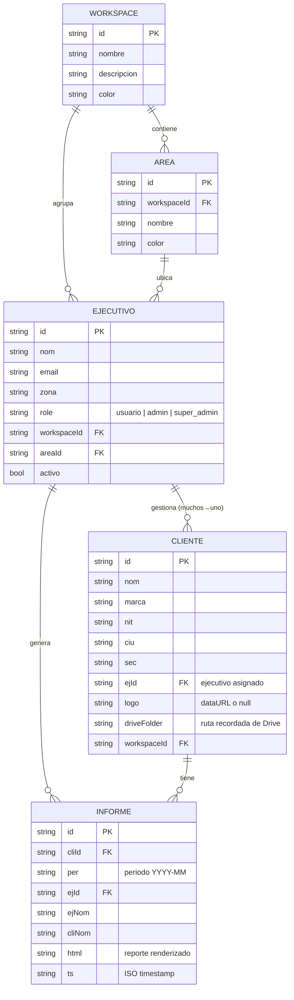

# Modelo de datos

La aplicación no tiene backend: todo el estado vive en el `localStorage` del navegador, en un
único objeto (`DB`, ver `src/models/db.js`) que se serializa bajo la llave `ps_v3`. Este
documento describe las entidades, sus campos y sus relaciones. Para cómo se accede a cada una
desde el código, ver [`ARCHITECTURE.md`](./ARCHITECTURE.md).

## Diagrama de entidades

## Entidades

### Ejecutivo (`models/Ejecutivo.js`)

Representa a cualquier persona que usa el sistema (el nombre viene de "ejecutivo de cuenta", pero
también cubre administradores y super-admins).

| Campo | Tipo | Notas |
|---|---|---|
| `id` | string | Único, generado con `utils/ids.js: nuevoId('e', …)` al crearse |
| `nom` | string | Nombre completo |
| `email` | string | Normalizado a minúsculas; es el vínculo con la cuenta de Firebase Authentication |
| `zona` | string | Ciudad/región, informativo |
| `role` | `'usuario' \| 'admin' \| 'super_admin'` | Ver tabla de roles abajo |
| `workspaceId` / `areaId` | string (FK) | A qué Workspace/Area pertenece |
| `activo` | bool | Una persona inactiva no puede entrar (la sesión se rechaza al cargar su perfil) |

### Cliente (`models/Cliente.js`)

Una empresa para la que un Ejecutivo genera informes mensuales.

| Campo | Tipo | Notas |
|---|---|---|
| `id` | string | `c<timestamp>` |
| `nom`, `marca`, `nit`, `ciu`, `sec` | string | Datos identificatorios |
| `ejId` | string (FK) | Ejecutivo asignado — relación **muchos Clientes → un Ejecutivo**, reasignable en bloque desde "Mi equipo" |
| `logo` | string\|null | Logo del cliente (dataURL), usado en el header del informe |
| `driveFolder` | string | Última ruta de Google Drive usada, para no tener que navegarla de nuevo |
| `workspaceId` | string (FK) | Espacio al que pertenece |

### Informe (`models/Informe.js`)

Un snapshot de un informe ya generado y guardado (append-only: no se edita, solo se crea o
borra).

| Campo | Tipo | Notas |
|---|---|---|
| `id` | string | `i<timestamp>` |
| `cliId`, `ejId` | string (FK) | A quién pertenece |
| `per` | string `YYYY-MM` | Periodo del informe |
| `ejNom`, `cliNom` | string | Copia denormalizada del nombre (para no depender de que el registro original siga existiendo) |
| `html` | string | El HTML completo renderizado (ver `services/htmlReport.service.js`) — es lo que se vuelve a descargar como HTML/PDF desde "Guardados" |
| `headcount`, `seleccion`, `rotacion`, `sst`, `nomina`, `fotos` | objetos/arrays | Los datos crudos de cada sección, por si se necesitan reprocesar |
| `ts` | string ISO | Fecha de creación |

### Workspace / Area (`models/Workspace.js`)

Jerarquía organizacional, gestionada solo por `super_admin`:

**Workspace** ("espacio", ej. *Proservis Temporales*) → **Area** ("área", ej. *Nómina*) →
**Ejecutivo**.

| Workspace | Area |
|---|---|
| `id`, `nombre`, `descripcion`, `color` | `id`, `workspaceId` (FK), `nombre`, `color` |

### ModuloConfig (`models/ModuloConfig.js`)

Preferencias de qué **módulos del informe** (`headcount`, `seleccion`, `rotacion`, `sst`,
`nomina`, `fotos` — ver `MODULOS` en `models/constants.js`) están activos para un usuario, con
posibilidad de sobreescribir por cliente. Se guarda dentro de `DB.moduloConfigs`, con llaves:

- `<userId>` → configuración global del usuario.
- `<userId>_<clienteId>` → override para ese cliente en particular.

## Roles y permisos

Hay tres roles guardados (`usuario`, `admin`, `super_admin`) y dos **perfiles derivados** que no se
guardan sino que se calculan en `models/Alcance.js`:

- **Ejecutivo líder** (`esLider`): arma y entrega el informe final de sus clientes. Es quien está
  como líder de un cliente (`cliente.ejId`), o pertenece a un área marcada «lidera el informe
  final» (`area.lidera`).
- **Trabajador de área**: aporta su parte (Selección, SST…) de los clientes donde figura en
  `cliente.asignaciones[areaId]`.

`capacidades(user)` decide qué ve cada quien; el menú y las rutas (`routes/RequireCap.jsx`) usan las
mismas claves.

| Pantalla (ruta) | Trabajador | Líder | Admin | Super admin |
|---|:---:|:---:|:---:|:---:|
| Inicio `/` | ✅ | ✅ | ✅ | ✅ |
| Mis aportes `/mis-contribuciones` | ✅ | ✅ (si tiene áreas) | ✅ | ✅ (elige el área) |
| Tablero del equipo `/colaborativo` | ❌ | ✅ | ✅ | ✅ |
| Mis clientes `/clientes` | ✅ (los suyos) | ✅ | ✅ | ✅ |
| Nuevo informe `/nuevo`, Guardados `/guardados`, Módulos `/config-modulos` | ❌ | ✅ | ✅ | ✅ |
| Mi equipo `/equipo`, Gestionar clientes `/aclientes`, Personas `/aejecutivos` | ❌ | ❌ | ✅ (su alcance) | ✅ |
| Espacios y áreas `/espacios`, Datos y cargas `/admin-data` | ❌ | ❌ | ❌ | ✅ |

El super admin además puede «Ver como» otra persona (suplantación solo de lectura de alcance; el
rol real sigue siendo el suyo para los permisos de administración).

## Persistencia

**Firestore es la fuente de verdad** (colecciones `ejecutivos`, `clientes`, `informes`, `workspaces`,
`areas`, `contribuciones`, `moduloConfigs`). Al iniciar sesión se carga todo desde el servidor
(`loadDB({ force: true })`); cada `saveDB()` sincroniza solo las diferencias (crear/actualizar/borrar
por id) con `services/firebaseSync.service.js`. La sincronización solo se habilita después de una
carga exitosa del servidor, para que una caché vieja nunca pise datos reales.

| Llave en el navegador | Contenido |
|---|---|
| `ps_v3` | Copia local del `DB` (caché de lectura rápida/offline). Se borra al cerrar sesión. |
| `gdrive_token`, `gdrive_token_time` | Token OAuth de Google Drive (expira a los 50 min) |

Los ids nuevos se generan con `utils/ids.js: nuevoId(prefijo, lista)` (único aunque se creen varios
registros en el mismo milisegundo, como en las cargas masivas).
